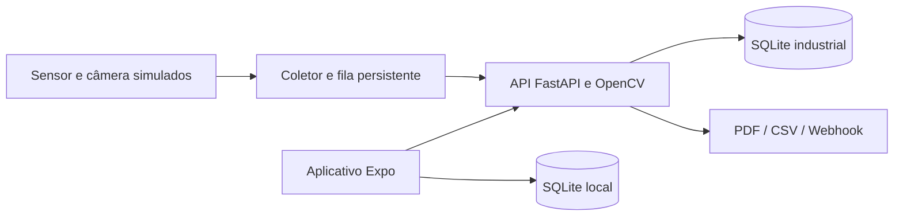

# Abaulytics

**Monitoramento do abaulamento de chapas de papelão ondulado por processamento de imagens.**

Projeto Interdisciplinar do curso de **Análise e Desenvolvimento de Sistemas da FATEC Indaiatuba**, desenvolvido em 2026 para a disciplina de **Laboratório de Engenharia de Software**, a partir de um problema real no contexto da **Irani**: identificar deformações de chapas que podem comprometer a qualidade e aumentar o refugo.

> **Estado do projeto:** protótipo acadêmico com medição manual, fluxo industrial simulado e testes automatizados. **Não está homologado para operação em uma linha industrial real.**

## Objetivo

Medir a flecha máxima de abaulamento, classificar a chapa e organizar resultados para acompanhamento da qualidade. O sistema é de monitoramento e não interfere fisicamente nas máquinas. O MVP foi concebido para uma linha de produção e análise da deformação no eixo vertical.

## Funcionalidades

| Módulo | Descrição |
| --- | --- |
| Cadastro e autenticação | Contas de bancada com e-mail, senha e sessão local. |
| Medição manual | Captura da chapa pelo celular, envio à API Python, cálculo do abaulamento em milímetros e classificação. |
| Dashboard de bancada | Totais de análises e ocorrências críticas. |
| Histórico de bancada | Consulta às leituras locais e relatório PDF por período. |
| Produção com crachá | Acesso por perfil, consulta de ordem de produção (OP), abertura/encerramento de lote e dashboard industrial. |
| Amostragem automatizada | Coletor de eventos com amostragem de 1 a cada 50 chapas, fila persistente e tratamento de duplicações e lacunas. |
| Histórico industrial | Consulta por período, OP, produto, largura e classificação; tendências e exportações PDF/CSV. |
| Administração e auditoria | Configuração de versões e calibrações, permissões por papel e registro de eventos. |
| Privacidade | Política, consentimento, correção, acesso, exportação e exclusão de dados, conforme funcionalidades do aplicativo. |

O fluxo industrial pode ser demonstrado com sensores e câmeras simulados. As funcionalidades dependem da configuração dos serviços e não significam validação física na fábrica.

## Stack tecnológica

| Camada | Tecnologias |
| --- | --- |
| Aplicativo | React Native 0.88.1, React 19.3.0, TypeScript 6.0.3, Expo SDK 58 |
| Interface | Expo Router, NativeWind |
| Captura | expo-camera |
| Backend | Python 3.11+, FastAPI, Uvicorn |
| Processamento de imagem | OpenCV, NumPy, Pillow |
| Persistência | SQLite local e SQLite para serviços industriais |
| Testes | `unittest` (Python), `node:test` (Node.js), simulação HTTP |
| Versionamento | Git e GitHub |

Consulte as dependências em [`package.json`](package.json) e [`api/requirements.txt`](api/requirements.txt).

## Arquitetura

O aplicativo móvel comunica-se com a API FastAPI. Na bancada manual, a foto é enviada ao servidor para cálculo da flecha; o histórico do usuário é mantido no dispositivo. No fluxo industrial, o coletor recebe eventos de passagem, registra amostras pendentes e encaminha os dados à API, que utiliza banco próprio e fornece dashboard, consultas e integração corporativa.



### Estrutura principal

```text
abaulytics/
├── app/                       # Telas e navegação
├── src/                       # Banco local, segurança, produção e privacidade
├── api/
│   ├── main.py                # API e medição manual
│   ├── industrial.py          # Rotas de produção
│   ├── collector.py           # Coleta de eventos
│   ├── industrial_cli.py      # Manutenção e simulação
│   ├── validate_bench.py      # Ensaio HTTP
│   ├── test_main.py
│   └── test_industrial.py
├── tests/security.test.cjs    # Testes de segurança
├── docs/                      # Documentação técnica e acadêmica
├── .env.example
└── package.json
```

## Pré-requisitos

- Git;
- Node.js **24** e npm;
- Python **3.11 ou superior** e pip;
- Expo Go **compatível com SDK 58** ou um development build equivalente;
- computador e celular na mesma rede para acessar uma API local;
- permissão de câmera no dispositivo.

## Instalação e execução

### 1. Clonar o repositório

```bash
git clone https://github.com/AndreySA04/abaulytics.git
cd abaulytics
```

### 2. Instalar dependências

```bash
npm ci
python -m pip install -r api/requirements.txt
```

O `npm ci` usa o lockfile e aplica os patches de dependências definidos no projeto.

### 3. Configurar o `.env`

No Windows (PowerShell):

```powershell
Copy-Item .env.example .env
```

No Linux/macOS:

```bash
cp .env.example .env
```

Edite o arquivo com o endereço da API **acessível pelo celular**:

```dotenv
# Exemplo: substitua pelo IP real do seu computador
EXPO_PUBLIC_API_URL=http://192.168.1.10:8000
EXPO_PUBLIC_PRIVACY_CONTROLLER=
EXPO_PUBLIC_PRIVACY_CONTACT=
```

O endereço acima é ilustrativo. **`127.0.0.1` em um celular físico aponta para o próprio celular.** Em ambiente de distribuição, configure **HTTPS** e preencha as informações de privacidade exigidas. Nunca inclua tokens ou senhas industriais em variáveis `EXPO_PUBLIC_*`, pois elas são públicas.

### 4. Iniciar o backend

Em um terminal na raiz do projeto:

```bash
python -m uvicorn api.main:app --host 0.0.0.0 --port 8000
```

A medição manual utiliza a rota `POST /api/analisar-chapa`.

### 5. Iniciar o aplicativo

Abra outro terminal:

```bash
npm run start
```

Use um Expo Go compatível com SDK 58 para abrir o projeto. Se necessário, limpe o cache do bundler:

```bash
npx expo start --clear
```

Scripts adicionais: `npm run android`, `npm run ios` e `npm run web`, conforme suporte do ambiente.

### 6. Utilizar a medição manual

1. Abra o app, crie uma conta e aceite a política e o consentimento necessários.
2. Entre na **Bancada** com e-mail e senha.
3. Inicie uma análise e informe a largura real da chapa em milímetros.
4. Autorize a câmera, enquadre a borda da chapa e capture a imagem.
5. Aguarde a medida e a classificação; consulte as análises no **Histórico** e exporte PDF por período.

Se houver falha de conexão, verifique o IP no `.env`, o Uvicorn, a porta 8000 e o firewall.

## Demonstração industrial simulada

A operação com crachá exige banco industrial e spool separados, credenciais de serviço, calibração e contas provisionadas. O roteiro de configuração, com as variáveis de ambiente e os comandos específicos para iniciar API e coletor, está em **[`docs/e2/OPERACAO.md`](docs/e2/OPERACAO.md)**.

Para executar o **ensaio automatizado isolado**, depois da instalação:

```bash
python -m api.validate_bench
```

Esse ensaio sobe processos locais, utiliza bancos e credenciais temporários, simula **100 passagens**, verifica as amostras nas chapas **50 e 100** e confere atualizações HTTP, exportações PDF/CSV e webhooks assinados.

Para uma demonstração interativa no app, siga o roteiro de operação: ative o modo `bancada`, provisione operadores, ative calibração sintética, crie uma OP, abra o lote em **Produção com crachá** e então execute:

```bash
python -m api.industrial_cli simulate --count 100
```

Não use credenciais ou bancos reais de produção na simulação.

## Testes automatizados

| Arquivo | Quantidade identificada | Cobertura principal |
| --- | ---: | --- |
| [`api/test_main.py`](api/test_main.py) | 23 | Cálculo de flecha, classificação, imagens sintéticas e inválidas, limites e erros da API. |
| [`api/test_industrial.py`](api/test_industrial.py) | 9 | Calibração estéreo, amostragem, persistência, idempotência, OP, permissões, consultas e integração. |
| [`tests/security.test.cjs`](tests/security.test.cjs) | 19 subtestes | Credenciais, autenticação, sessões, privacidade, auditoria e controles de acesso. |

Foram identificados **51 casos individuais no código analisado**, além do ensaio HTTP e verificações estáticas. Essa contagem **não significa que os 51 tenham sido executados e aprovados na versão mais recente**.

Para executar os testes:

```bash
npm run typecheck
npm run test:security
npm run test:api
python -m api.validate_bench
```

Validação adicional de configuração de distribuição:

```bash
npm run check:release
```

Esse último comando exige URL HTTPS e os campos de privacidade preenchidos.

### Evidências documentadas

A [matriz da entrega anterior](docs/e2/E2.md) registra **27 testes de API e 19 testes de segurança aprovados**, além de checagem TypeScript e ensaio de 100 passagens. Nesse ensaio, as amostras chegaram ao cliente HTTP em **263 ms e 174 ms**. **Esses tempos não comprovam a renderização no dispositivo móvel em até 2 segundos.** Para a entrega final, execute novamente os testes e guarde a saída do terminal, a data e o ambiente.

## Regras de classificação

A medida é expressa em milímetros. Na bancada, a classificação utiliza três faixas; na produção, permanece a regra de conformidade definida pelo projeto.

| Contexto | Valor | Classificação |
| --- | --- | --- |
| Bancada | Menor que 11,800 mm | Sucesso |
| Bancada | De 11,800 até 12,000 mm, inclusive | Atenção |
| Bancada | Maior que 12,000 mm | Crítico |
| Produção | Até 12,000 mm, inclusive | Conforme |
| Produção | Maior que 12,000 mm | Não conforme |

A faixa de Atenção é um aviso da bancada e **não altera** o limite industrial de 12 mm. O projeto considera a flecha máxima e registra a relação entre leituras industriais, lotes/OP e configurações do algoritmo.

## Privacidade e segurança

O Abaulytics implementa mecanismos de proteção de credenciais, controle de sessão, autorização por perfil, consentimento e auditoria. O armazenamento da bancada é local; os serviços industriais usam armazenamento próprio.

- Não comite `.env`, chaves, tokens, senhas ou dados reais da empresa.
- Fora do desenvolvimento, a API requer HTTPS.
- Acesso às rotas industriais depende de permissões.
- Os controles implementados e os testes **não são certificação LGPD**.

Consulte [`docs/PRIVACIDADE.md`](docs/PRIVACIDADE.md), [`docs/MAPA_DADOS.md`](docs/MAPA_DADOS.md), [`docs/CHECKLIST_LGPD.md`](docs/CHECKLIST_LGPD.md) e [`docs/OPERACAO_PRIVACIDADE.md`](docs/OPERACAO_PRIVACIDADE.md).

## Limitações e homologação pendente

O protótipo precisa de validação física na linha industrial da Irani, especialmente quanto a:

- precisão de **0,2 mm**, medida contra referência rastreável;
- latência de captura até a **exibição efetiva no celular**, com limite previsto de **2 segundos**;
- disponibilidade de **95%** durante o período produtivo;
- funcionamento com poeira, iluminação variável e velocidade de até **237 m/min**;
- integração definitiva com sensores, câmeras e sistemas corporativos;
- avaliação dos controles aplicáveis às normas ISO citadas na documentação do PI.

Esses valores são **requisitos de aceitação**, não medições comprovadas em produção. O teste HTTP e a exportação dos bundles móveis não substituem homologação de campo.

## Documentação complementar

- [Operação, simulação e homologação](docs/e2/OPERACAO.md)
- [Plano e resultados de testes E2](docs/e2/E2.md)
- [Diagramas de modelagem e arquitetura](docs/e2/diagramas/)
- [Auditoria de aderência](docs/e2/AUDITORIA-E-PLANO.md)
- [Atualização Expo SDK 58](docs/UPGRADE_EXPO_58.md)
- [Política de privacidade](docs/PRIVACIDADE.md)

## Equipe

**FATEC Indaiatuba — Análise e Desenvolvimento de Sistemas**  
**Laboratório de Engenharia de Software — 2026**

- Alan Suzuki
- Andrey de Souza Almeida
- Gabriel Stocco
- Heitor Vicenzo Cantuaria
- João Gabriel Rebouças Dias
- Rafael Alexandre De Oliveira

**Contexto do projeto:** Irani, monitoramento do abaulamento de chapas de papelão ondulado.

---

*Protótipo acadêmico desenvolvido para o Projeto Interdisciplinar. A utilização operacional depende de validação e homologação industriais.*
