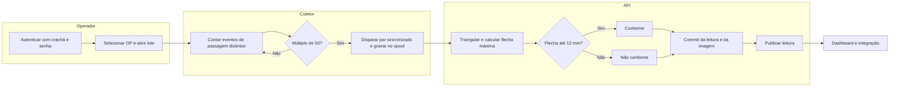
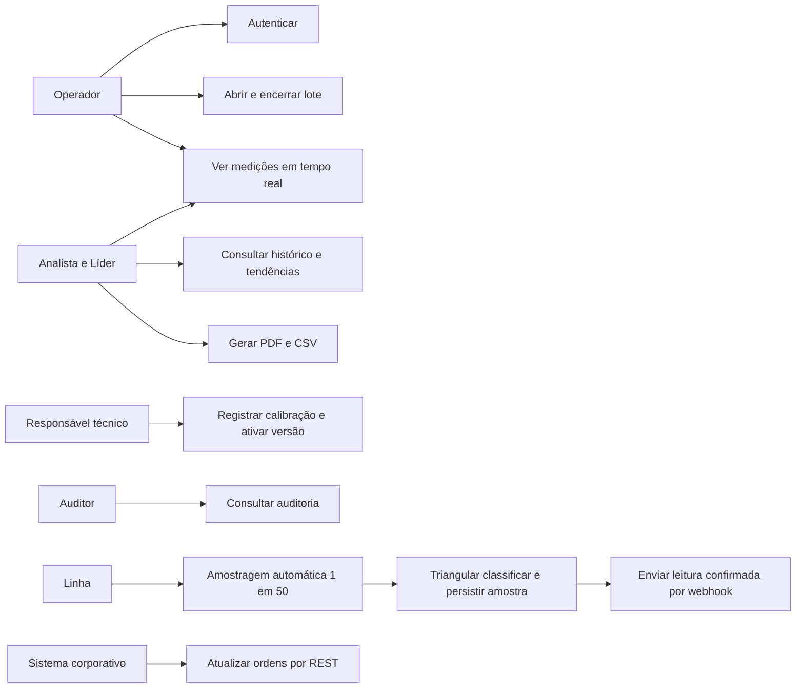
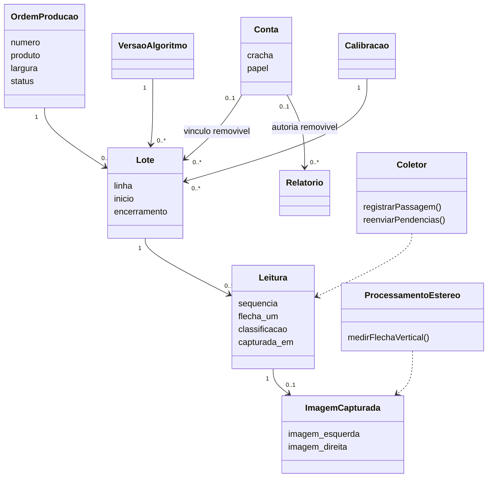
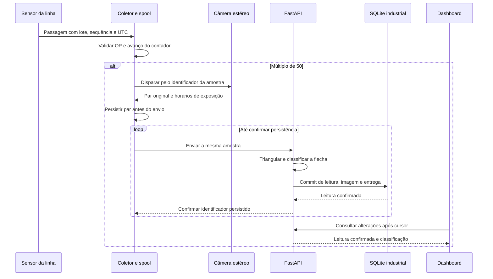
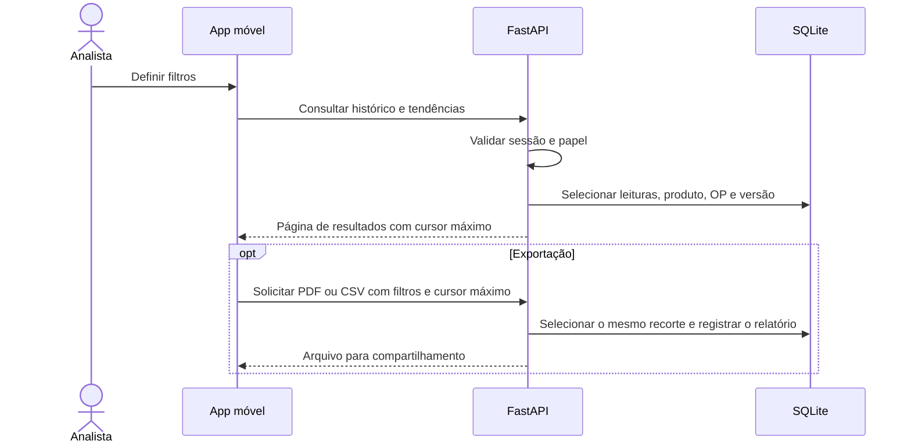
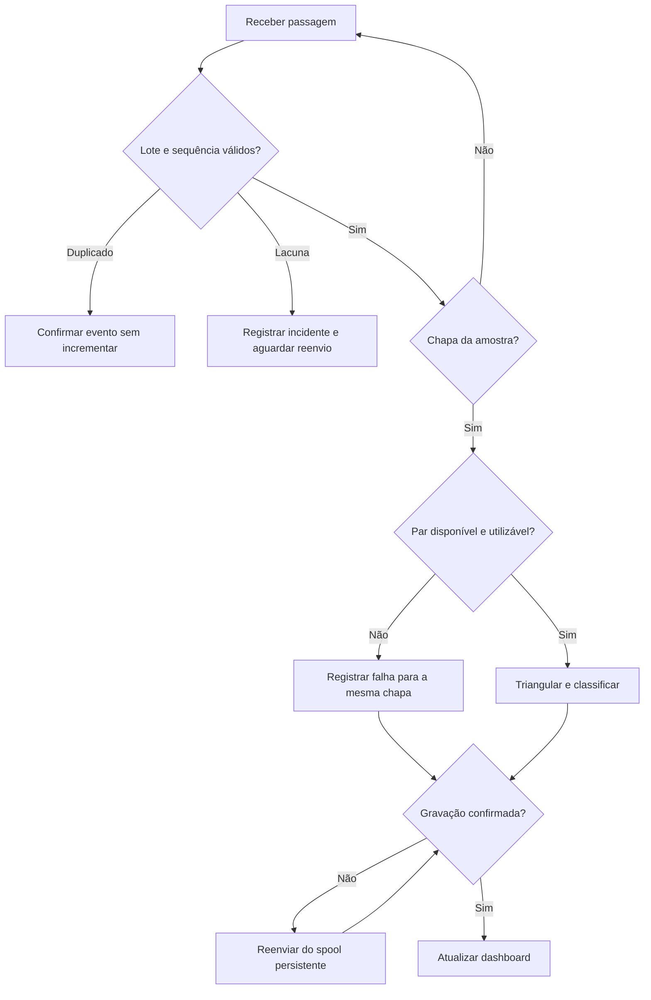
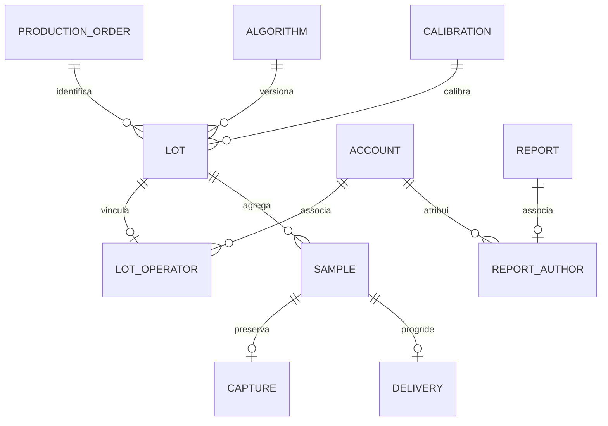
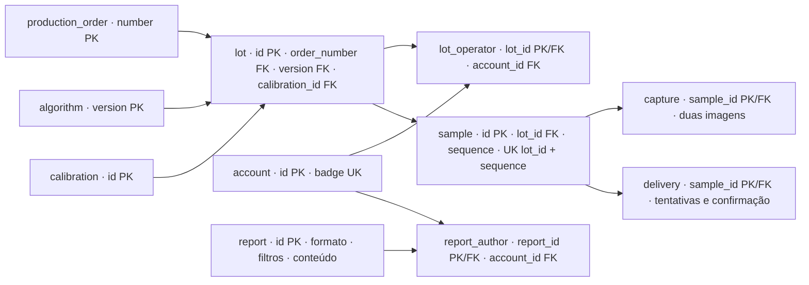
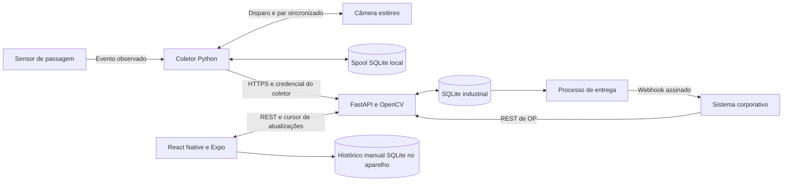

# Abaulytics — E2 revisada

Fatec Indaiatuba · Laboratório de Engenharia de Software · Cliente Irani · 2026

Alan Suzuki · Andrey de Souza Almeida · Heitor Vicenzo Cantuaria · João Gabriel Rebouças Dias

## 1. Identificação

O Abaulytics monitora o abaulamento de chapas de papelão ondulado. A medição por amostragem permite acompanhar não conformidades na produção, consultar evidências e orientar ações de redução de refugo.

Esta revisão descreve a implementação do fluxo industrial e os critérios de homologação. O [texto original](E2-texto.md) e os [diagramas extraídos da entrega original](AUDITORIA-E-PLANO.md#fontes-e-extrações) documentam a versão anterior. O repositório do projeto é [AndreySA04/abaulytics](https://github.com/AndreySA04/abaulytics).

## 2. Escopo e requisitos

O modo **Produção** monitora uma linha com um lote ativo, sensor de passagem, câmera estéreo sincronizada e API local. A análise usa o eixo vertical da borda e entrega uma única flecha máxima. A linha continua sob operação do maquinário existente. O modo **Bancada** mantém a foto manual, os resultados estimados e o histórico individual em outro fluxo.

| RF | Comportamento |
| --- | --- |
| RF01 | Capturar a cada 50 passagens consecutivas do lote ativo. Eventos duplicados contam uma vez. |
| RF02 | Triangular a borda em um par estéreo calibrado, com referência física em milímetros. |
| RF03 | Encontrar a maior distância vertical absoluta à reta que une as extremidades da borda. |
| RF04 | Publicar a leitura confirmada e atualizá-la no dashboard aberto em até 2 s, da captura à exibição. |
| RF05 | Classificar em Conforme para flecha até 12 mm inclusive, e Não conforme acima de 12 mm. Falha de imagem é registrada sem classificação. |
| RF06 | Guardar a leitura, a OP, a largura, o horário UTC da captura e o par original de imagens. Vincular a versão e a calibração usadas. |
| FR07 (RF07) | Consultar por período, OP, produto, largura e classificação. PDF e CSV usam o mesmo recorte da consulta. |
| RF08 | Registrar e ativar versões compatíveis entre lotes. Reversão usa uma versão já registrada e conserva os resultados emitidos. |

| RNF | Critério |
| --- | --- |
| RNF01 | Erro absoluto de até 0,20 mm em ensaio contra referência física rastreável. |
| RNF02 | Até 2 s da captura à renderização por leitura no ensaio operacional. Registrar atrasos e amostras sem renderização válida. |
| RNF03 | Pelo menos 640 × 480 por vista e exatamente a resolução da calibração ativa. |
| RNF04 | Pelo menos 95% de disponibilidade no período produtivo observado, considerando a cadeia da passagem ao dashboard. |
| RNF05 | Operar com as condições de poeira e iluminação variável da linha a qualificar. |
| RNF06 | Preservar amostras confirmadas pelo coletor em rede indisponível, reinício ou falha transitória de gravação, com fila persistente e reenvio idempotente. |
| RNF07 | Proteger registros com identidade, autorização por papel, credenciais de serviço, trilha, restrição de alterações e controles operacionais de armazenamento. |
| RNF08 | Qualificar a captura e o processamento com a linha a até 237 m/min, considerando o espaçamento real das chapas. |
| RNF09 | Rastrear e demonstrar os itens aplicáveis de ISO 9001 e ISO 14001 definidos com a Qualidade da Irani. |

| RN | Regra |
| --- | --- |
| RN01 e RN02 | Até 12.000 µm inclusive é Conforme. Acima é Não conforme. O valor calculado é arredondado a 1 µm, com empate para cima, antes da classificação e do armazenamento. |
| RN03 | A cada abertura de lote, o contador recomeça em zero. A linha amostra as chapas 50, 100, 150 e os múltiplos seguintes. |
| RN04 | Toda leitura pertence a uma OP válida no momento da passagem. A largura, o produto e a configuração ficam congelados no lote. |
| RN05 | Leituras e imagens industriais são preservadas. A remoção de conta desfaz a associação pessoal e mantém a evidência industrial. |
| RN06 e RN07 | A classificação usa apenas a flecha máxima vertical. A triangulação usa duas vistas como etapa geométrica intermediária. |
| RN08 | O coletor encaminha capturas com prioridade. O servidor reserva capacidade para medição e limita exportações simultâneas. O webhook tem reenvio próprio. |
| RN09 | Uma versão ou calibração já publicada continua associada às leituras emitidas. A versão ativa pode mudar entre lotes. |
| RN10 | Tendência por dia UTC e OP, com válidas, não conformes e falhas. A taxa é calculada sobre amostras válidas. |

## 3. Processo de produção

## 4. Diagramas UML

### 4.1 Casos de uso

### 4.2 Classes de domínio e serviços

### 4.3 Sequência de captura automática

### 4.4 Sequência de histórico e relatório

### 4.5 Atividades e falhas

## 5. Banco de dados

### 5.1 DER conceitual

### 5.2 Modelo lógico

### 5.3 Dicionário

| Tabela | Campos operacionais |
| --- | --- |
| `account` e `session` | Crachá único, nome, papel, verificador de senha, token armazenado como hash e validade. |
| `production_order` e `lot` | OP, produto, largura em µm, status, instalação de uma linha, início e fim UTC. Lote congela produto, largura, versão e calibração. |
| `algorithm`, `calibration` e `configuration` | Código da versão, método implementado, parâmetros estéreo, data de registro e seleção ativa. |
| `sample` e `capture` | Identificador, lote, sequência, horário da passagem e captura, flecha inteira em µm, classificação derivada, falha opcional, hash de idempotência e BLOB das duas vistas. Uma medição válida tem um par. |
| `lot_operator`, `report_author` e `audit_actor` | Associações de conta removíveis. O lote, o relatório e a trilha continuam disponíveis. |
| `report` e `delivery` | Relatório com filtro e cursor persistidos. Fila corporativa com tentativas, disponibilidade de reenvio e aceite. |
| `line_incident` e `collector_health` | Lacunas de contagem, último contato do coletor e quantidade de amostras pendentes. |

## 6. Arquitetura

## 7. Plano e resultados de testes

| Caso | Procedimento e resultado esperado | Estado |
| --- | --- | --- |
| E2-01 · RF01, RN03, RN04 | Enviar 100 passagens. Chapa 50 e 100 capturadas. Duplicata preserva contador. Lacuna aguarda retomada em sequência. OP inválida é rejeitada. | Aprovado em testes e bancada HTTP |
| E2-02 · RF02, RF03, RF05, RN01/02/06/07, RNF03 | Usar perfis estéreo sintéticos planos, curvos e inclinados e par abaixo de 480p. Testar 11,999, 12,000 e 12,001 mm. | Aprovado em testes |
| E2-03 · RF06, RF08, RN05/08/09, RNF06/07 | Interromper gravação e transporte, repetir a amostra após reinício, alternar versão e desvincular o operador. Mesma amostra gera uma leitura e um par, com histórico preservado. Testar acesso por papel. | Aprovado em testes |
| E2-04 · RF04, FR07, RN10 e integração | Consultar alterações após cursor. Conferir filtros, tendências, PDF/CSV e webhook autenticado com chave de idempotência. | Aprovado em testes e bancada HTTP. Renderização nativa pendente |
| E2-05 · RNF01/02/03/04/05/08 | Executar roteiro com instrumento rastreável, câmera física e dashboard em aparelho na linha da Irani, incluindo luz, poeira, disponibilidade, latência e velocidade. | Pendente de homologação industrial |
| E2-06 · RNF09 | Registrar edição e itens aplicáveis, controles, lacunas e evidências com a Qualidade. | Pendente de validação institucional |

Ambiente da bancada automatizada com Python 3.14, SQLite e OpenCV, em Windows. A API e o coletor executaram em processos separados e o receptor corporativo foi simulado em loopback. Passaram 27 testes da API, 19 testes de segurança local, checagem TypeScript e exportação dos bundles Android/iOS. No ensaio com 100 eventos, as duas amostras chegaram ao cliente HTTP em 263 ms e 174 ms, respectivamente. A homologação usa a renderização no aparelho como ponto final.

## 8. Manual do sistema

Use o [manual de operação e homologação](OPERACAO.md) para instalar, simular uma linha, integrar sensor e câmera, emitir relatórios, lidar com falhas e coletar evidências para a Irani.
